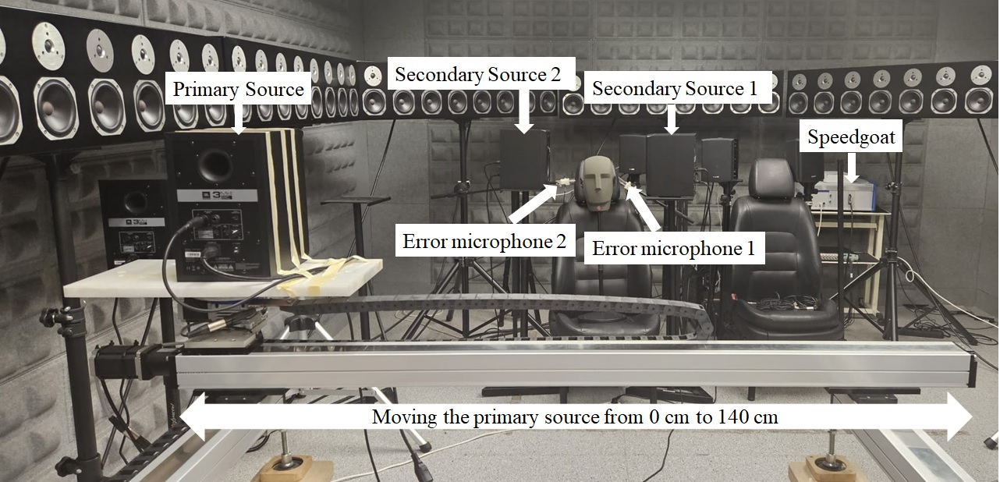
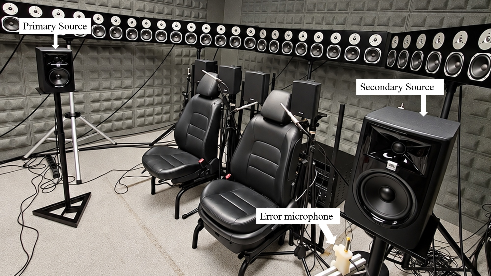

# GeIAEKF-MIMO-ANC

## Table of Contents
- [GeIAEKF-MIMO-ANC](#geiaekf-mimo-anc)
  - [Table of Contents](#table-of-contents)
  - [Introduction](#introduction)
  - [Repository Contents](#repository-contents)
  - [Demo](#demo)
  - [Run explanation](#run-explanation)
    - [Matlab model](#matlab-model)
    - [Simulink model for real-time implementation](#simulink-model-for-real-time-implementation)
  - [Acknowledgements](#acknowledgements)

## Introduction

In this project, the proposed GeIAEKF (Generalized error Innovation based Adaptive Estimation Kalman Filter) algorithm is implemented in Simulink and deployed on a real-time Speedgoat target to cancel narrowband noise using a feedforward MIMO ANC configuration. This algorithm update both process and measurement noise covariance matrix online. This makes the algorithm robust to changes in the environment while running, such as moving the primary noise source to a different position.
The GeIAEKF algorithm is compared with other algorithms such as eIAEKF (error Innovation based Adaptive Estimation Kalman Filter), AKL (Adaptive Kalman-like), SKF (Standard Kalman Filter), NLMS (Normalized LMS). The comparisons are done in different scenarios such as “multi-channel static”, “single channel different noise”, “single channel moving noise source”, “single channel road noise”, “single channel changing acoustic path”.
This repository provides two ways to run the algorithm: a MATLAB script implementation and a Simulink model for real-time execution on a Speedgoat target.

## Repository Contents

````text
PIME-FxNLMS/
├── Images/
├── Matlab/
│   ├── Changing_acoustic_path/
│   ├── Multi-Channel_Static/
│   ├── road_noise/
│   ├── Single-channel_different_signals/
│   └── Single-channel_moving_noise_source/
├── Simulink/
│   ├── adaptative_kalman_like_1x1x1.slx
│   ├── eIAEKF_1x1x1.slx
│   └── ...
├── Article_2_Tahmida_source_2nd_edition.pdf
└── README.md
    
````


## Demo

The real-time implementation runs on a Speedgoat target, with the acoustic setups shown below:


Figure 1: Physical real-time MIMO ANC setup     
    

Figure 2: Physical real-time SISO ANC setup

- Real-time target: Speedgoat performance P3
- Conditioning amplifier: B&K Type 2694
- Error microphone: B&K Type 4958
- Noise source loudspeaker / ANC loudspeaker: JBL Professional 305P MkII

The following video shows the GeIAEKF algorithm working in real time on Speedgoat, with the reference noise playing continuously and the primary source position being changed continuously with a constant speed to check the tracking performance of GeIAEKF. Same experiment has been repeated for NLMS and Standard Kalman Filter algorithms for comparison.

https://github.com/user-attachments/assets/bdef7bc1-d2eb-4020-ae44-d1b7e5543fbe


## Run explanation

### Matlab model

The GeIAEKF, eIAEKF, SKF, NLMS, Adaptive Kalman-like  implemented in MATLAB code uses two files:
- `fx_algorithm_name.m`  
  
These are the control algorithm function files that controls the ANC according to the different algorithms 

- `anc_algorithm_name.m`
- Defines the algorithm parameters, generate the acoustic paths, runs `fx_algorithm_name.m`, and plots the resulting signals and curves. This is the only file that needs to be run.
  
### Simulink model for real-time implementation

The GeIAEKF, eIAEKF, SKF, NLMS, Adaptive Kalman-like implemented in real-time Simulink models:
- `Algorithm_name_1x1x1.slx`
These are the slrt models used in the demo to run the algorithms for SISO ANC in real time on a Speedgoat. To configure the parameters edit and run `Initialization_1x1x1.m`.
- `Algorithm_name_1x2x2.slx`
These are the slrt models used in the demo to run the algorithms for MIMO ANC in real time on a Speedgoat. To configure the parameters edit and run `Initialization_1x2x2.m`.

## Acknowledgements
The precompiled MEX files in matlab code/ (rir_generator.mexw64 and rir_generator.mexmaci64) were compiled from the RIR-Generator project by Emanuël A. P. Habets, which implements the image-source method for generating room impulse responses. They are used in acoustic_paths_gen.m to simulate the primary and secondary acoustic paths.
RIR-Generator is distributed under the MIT License; its copyright notice and license text are included in matlab code/RIR-Generator-LICENSE.txt.


